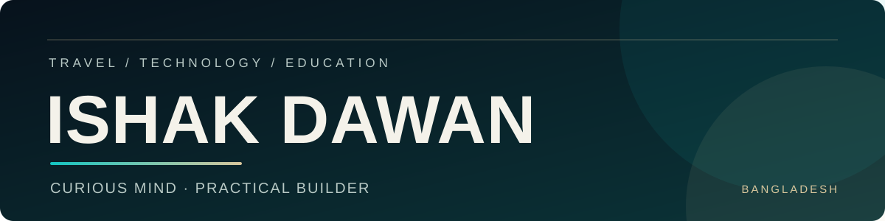
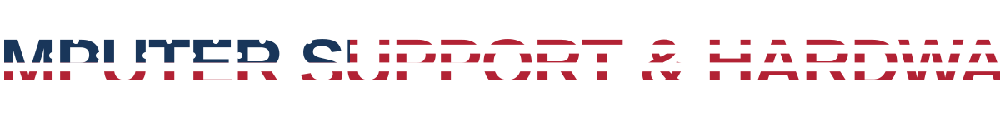

  

I’m interested in how people experience places, how technology can solve practical problems, and how good ideas become useful products.

---

## EDUCATION

**Associate Degree** · ASA College · New York, USA

*Computer Support Specialist / Computer Hardware Specialist*

Technical interests: IT support · Computer hardware · Networking

---

## SELECTED WORK

- **[Next Border](https://nextborder.online)** — Visa and education consultancy for students, visitors and work-permit applicants.
- **Dawan Trade Link** — Paris–Dhaka fragrance brand behind L-un.
- **NORA** — AI-assisted English-learning concept for guided practice and IELTS speaking.
- **Tripsilo** — Travel and tour services, from flights and stays to complete trips.

---

## TRAVEL NOTES

United States · South Korea · Malaysia · China · Thailand · India · Japan

---

## CURRENT INTERESTS

AI and automation · Web and app products · Travel and education technology

  EXPLORE / BUILD / LEARN / SHARE

